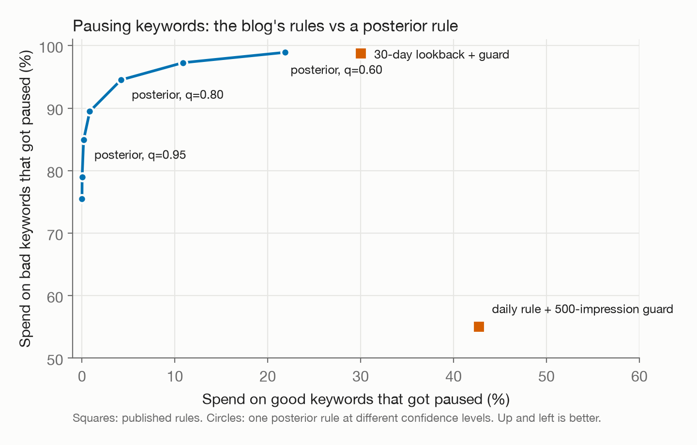
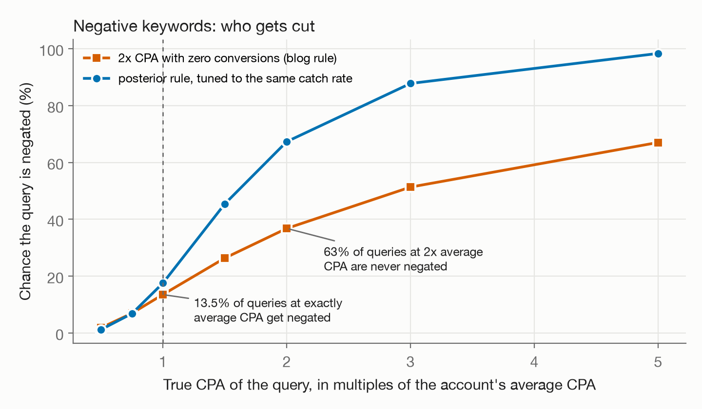

# pausebench

**How often do published ad-ops rules pause the wrong thing?** A small simulator with known ground truth, run
against three pause, negate and fatigue rules from the Hellyeah blog, and a sample-size-aware replacement for each,
tuned on training seeds and scored on held-out seeds.

Built in one evening (2026-11-06) as an outside look at the "pause/boost decisions" part of Hellyeah's Learn Engine
role. It uses only public posts. Nothing here claims to know what Hellyeah runs in production.

<p align="center"></p>

## The three rules

| id | Post (all by Jay Ma) | Rule as written |
|---|---|---|
| R1 | [Google Ads Optimization Checklist](https://www.hellyeahai.com/blog/google-ads-optimization-checklist), Nov 2 | "Any query that has spent 2x your average CPA with zero conversions gets added to the negative keyword list immediately." |
| R2 | [Google Ads Automated Rules That Actually Work](https://www.hellyeahai.com/blog/google-ads-automated-rules-that-work), Oct 14 | A daily CPA pause rule plus the post's fix: "500 impressions for CPA-based rules before any action triggers", which "blocks 70-80% of false-positive rule fires". |
| R3 | [Ad Creative Fatigue](https://www.hellyeahai.com/blog/ad-creative-fatigue), Oct 19 | "When Hellyeah's AIMA engine detects that a creative's CTR has fallen 20% or more from its launch baseline for five consecutive days while frequency is rising above 3.0, it flags the creative." |

## What came out

**R2, the 500-impression guard.** The post's 70 to 80% claim holds by count: in the default portfolio the guard blocks
92% of false pauses. It blocks only 52% by spend. The guard filters out small keywords. It does nothing about daily
re-testing, so the false pauses it leaves are on the keywords that carry the money. A keyword whose true CPA is 20%
*better* than target, at 1,000 impressions a day, is paused within a week 97% of the time with the guard on (90% at
3,000 a day). Across five settings (median volume 20 to 200 impressions a day, CTR 2% to 8%) the guard blocks 74 to 98%
of false pauses by count and 25 to 76% by spend.

A posterior rule on cumulative data (pause when P(CPA > target | data) > q) beats both published variants on spend.
At q = 0.80 it pauses 4.2% of good-keyword spend and catches 94.5% of bad-keyword spend. The daily rule with the guard
pauses 42.7% and catches 55.0%. Matched to the catch rate of the post's best variant (30-day lookback plus guard), it
pauses less good spend in all five settings (for example 17.8% vs 30.0% at the default).

**R1, negate at 2x CPA with zero conversions.** This one has a closed form: a query with true CPA `c` (in multiples of
the account average) is negated with probability `exp(-2/c)`. The simulation matches it to within 0.5 points.

- A query converting at exactly the account's average CPA is negated 13.5% of the time.
- A query at *twice* the average CPA escapes 63% of the time. The rule is a one-shot check, so one lucky conversion
  before 2x spend clears a bad query for good.
- A negation is permanent, so the account never sees the evidence that would show it was wrong.

<p align="center"></p>

Over a 2,000-query portfolio the posterior rule, tuned to R1's catch rate, loses 39% fewer good-query conversions to
negation (1.39% vs 2.26% of all good-query conversions at the default spread). It is not a clean win per query: it
negates a query at exactly average CPA slightly more often (17.6% vs 13.5%) and catches bad queries far more often.

**R3, the fatigue flag.** As written it almost never false-alarms (1.2% at 1,000 impressions a day, 0% at 100,000). It
also catches only 40 to 47% of creatives whose true CTR fell 20% within the month, and that rate does not move with
volume. The frequency gate decides, not the data: a creative on a large audience can lose 20% of its CTR while 7-day
frequency stays under 3.0. Without the gate the rule catches 76 to 89% but false-alarms up to 7.7% at low volume.

A challenger (baseline shrunk toward the cohort, a pooled 5-day window, and a one-sided bound that includes day-to-day
noise) was tuned on training seeds to R3's false-alarm rate. On held-out seeds, at 10,000 impressions a day, it catches
84% of fatigued creatives vs R3's 46%, and cuts fatigued days left unflagged from 12.5 to 7.8. At 1,000 a day the gain
is small (13.9 to 13.2 days).

The R3 numbers depend on how creatives wear out (decay with frequency, audience sizes, how concentrated delivery is).
Those are my assumptions, not measurements. **The question this raises: in real accounts, what share of creatives that
lost 20% of CTR did so with 7-day frequency under 3.0?** If the share is small, the gate is fine. If it's large, the
flag misses most fatigue.

**Winner's curse.** Creative testing picks winners on noisy launch data, which inflates the 72-hour baseline. In the
"best of four at 72 hours" arm, the ungated rule's false-alarm rate roughly doubles at low volume (7.7% to 14.8% at
1,000 a day, 3.2% to 6.0% at 3,000). The shrunk baseline in the challenger is the fix.

## Answering "would you let it auto-pause?"

Jay [asked](https://x.com/doudoujay/status/2110808183317131637) whether an agent should auto-pause or always ask
before touching spend. The R2 frontier gives a direct answer as approval tiers on one posterior:

| Posterior P(CPA > target) | Action | Good-keyword spend touched | Bad-keyword spend caught |
|---|---|---|---|
| above 0.95 | pause automatically | 0.2% | 84.9% |
| 0.70 to 0.95 | ask the owner | another 10.7% | another 12.4% |
| below 0.70 | leave running | | |

(Default portfolio, 20 held-out seeds.) The confident tier does most of the work with almost no collateral, and the
owner only sees the cases where the data cannot decide.

## How it was checked

- **Preregistered.** [`PREREG.md`](PREREG.md) fixed the rules, ground truth, metrics, challengers, scenarios, training
  seeds and held-out seeds in commit `cf2034f` before anything was scored. Every change made after the first run is
  listed at its bottom with its reason. One of them helped the published rule: the first R3 generator could never
  produce 7-day frequency above 3.0, so its gate never opened.
- **Held-out scoring.** Every challenger threshold was tuned on seeds 0 to 9 and scored on seeds 100 and up.
- **Closed form.** R1's simulated curve matches `exp(-2/c)` at every point.
- **Sweeps.** R1 over three CPA spreads, R2 over five volume and CTR settings, R3 over three noise levels and two arms.
- **Independent review.** A fresh reviewer read the code against the quoted rules. Findings and fixes are in
  [`docs/review.md`](docs/review.md).

## What did not hold, and limits

- At the narrowest CPA spread (sigma 0.3), R1's challenger threshold tuned on training seeds did not carry over to the
  held-out seeds: it caught 3.6% of bad queries vs R1's 7.4% (about 20 bad queries per seed). It still lost far fewer
  good conversions (0.70% vs 3.80%), but it is not the equal-power comparison the preregistration asked for.
- R3's challenger is slower than the rule at low volume on the creatives both catch (median delay 11 vs 8 days at
  1,000 a day). Its gain there comes from catching more creatives, not from catching them sooner.
- Everything is simulated. The rules' failures in R1 and R2 come from counting statistics alone, so they should carry
  over to real accounts. R3's depend on the wear-out model.
- These are rules from blog posts. The [docs](https://docs.hellyeahai.com) say the current product does not change
  live campaigns without approval, so this is about the policy the Learn Engine would automate, not about live behavior.

## Reproduce

```bash
uv sync
uv run python -m pausebench.r1_negate          # about 10 s
uv run python -m pausebench.r2_cpa_guard --all # about 30 s
uv run python -m pausebench.r3_fatigue         # about 15 s
uv run python -m pausebench.figures
```

Outputs land in `results/` (text and JSON) and `docs/` (charts). Python 3.11+, numpy and scipy.

| Path | What it holds |
|---|---|
| `pausebench/r1_negate.py` | R1, its Gamma-Poisson challenger, the closed-form check |
| `pausebench/r2_cpa_guard.py` | R2 daily, guarded, 30-day lookback and posterior rules; the frontier |
| `pausebench/r3_fatigue.py` | Creative wear-out generator, R3 with and without the gate, the challenger |
| `PREREG.md` | The plan as committed before scoring, and every later change |
| `results/` | Raw outputs from the runs above |
